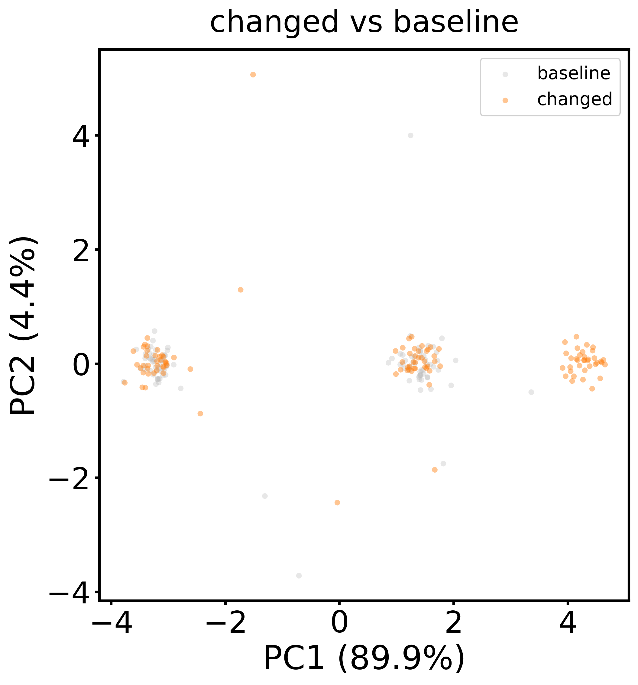

# Shared PCA and HDBSCAN: two tutorials

**Author's Note:** This pipeline was initially developed for a Slurm high-performance computing (HPC) environment (hence its headless-safe plotting and chunked memory handling), but it is completely self-contained and designed to run locally on any standard computer without modification.

This pipeline fits one PCA to observations pooled from the systems in a config
file, then runs HDBSCAN **separately on each system** in that shared PC space.
The examples are separate runs: their PC coordinates cannot be compared to
each other.

## 1. Install

Open a terminal in the repository root:

```bash
conda create -n shared-pca -c conda-forge python=3.11 mdtraj hdbscan
conda activate shared-pca
python -m pip install -r requirements.txt
```

No GROMACS executable is needed for these supplied examples.

Before going into the examples, you can run `python smoke_test.py`. It is a disposable regression test that verifies the correct installation of the libraries.

## 2. Molecular Dynamics (Protein trajectory) 

The initial usage of this analysis was on protein simulations, so one of the tutorials
reflects the initial usage of the employed combination.

The inputs are already in `examples/protein/data/`: `example.gro` (topology),
`example_traj.xtc` (trajectory) and `example_index.ndx` (atom group). The config selects
CA atoms from the `Protein` group, aligns frames to the first frame and uses
the whole trajectory.

```bash
python cluster_hdbscan.py examples/protein/config.yaml
python plot_medoids.py examples/protein/config.yaml
```

Open `examples/protein/results/reps_protein/pca_scatter.png`. Each dot is a
frame; colors show clusters and gray means noise. If a cluster exists,
`reps_protein/reps/cluster_0_rep.pdb` is an **actual frame** selected as a
representative in retained PC space (medoid representation). In `reps_protein/`, the corresponding
`labels.npy`, `pca_coords.npy` and `probabilities.npy` store assignments,
PC coordinates and membership strengths. The overview is
`examples/protein/results/shared_pca_medoids.png`.

This one-system tutorial shows the trajectory route. To compare conditions,
add other systems to the same config with corresponding selected atoms in
the same order.

## 3. Sensor readings: another type of problem

PCA and HDBSCAN analysis aren't exclusive for MD simulations!
Imagine observing a motor with four measurements at each observation:
`vibration`, `motor_current`, `temperature` and `acoustic`. These CSVs are
**synthetic**, with comparable arbitrary units. `baseline.csv` has two
operating modes (`idle`, `running`); `changed.csv` has those plus `high_load`.
Both contain a few unusual rows. The `state` column documents how the toy
data were made and is **excluded** from PCA and clustering.

The useful question is: *does the changed condition occupy the same regions
as baseline, or does it introduce a new group of readings?* This shows
pattern discovery, not validated fault detection.

```bash
python cluster_hdbscan.py examples/sensors/config.yaml
python plot_medoids.py examples/sensors/config.yaml
```

Start at `examples/sensors/results/reps_changed/vs_reference_pca_space.png`:



- Each dot is one CSV row. **Gray** shows baseline; **orange** shows changed.
  They use the **same pooled PCA axes**. The `reference: baseline` setting
  only picks the gray background for CSVs; no rows are subtracted or aligned.
- Two orange groups overlap gray groups because both conditions contain
  `idle` and `running` readings. The additional orange group on the **right**
  is the introduced `high_load` mode in this synthetic example. Isolated dots
  are unusual observations.
- PC1 and PC2 are combinations of all four features, **not time or named
  sensors**. Their signs and exact coordinates have no inherent meaning.
  Here PC1 explains about 90% of pooled variance and PC2 about 4%.

This overlay shows **where the two conditions lie**, not HDBSCAN's cluster
colors. See `reps_baseline/pca_scatter.png` and
`reps_changed/pca_scatter.png` for the assignments. Then open
`shared_pca_medoids.png`: its table gives cluster counts and percentages;
the panels display cluster representatives. `cluster_ids: [0, 1, 2]` requests
three slots; `N/A` means that system has no cluster of that number. Cluster
IDs are assigned by size within each system, so match groups by position
and underlying readings, **not by cluster number**.

Each `reps_<system>/reps/cluster_<id>_rep.csv` contains an original CSV row.
`source_row` starts at 1 for the first data row after the header. Regenerate
the committed CSVs with `python examples/sensors/generate_data.py` (fixed
seed). The noise label `-1` means unassigned by HDBSCAN; it does not prove a
real fault.

## 4. Adapt it

Copy an example config and edit the system names, paths and `reference`.
Paths are relative to the config file. For CSV input, use `input_type: csv`
and the same ordered, finite numeric `features` in each file. Scale columns
**consistently across systems** if their units differ widely; the pipeline
does not scale them. For trajectories, selected atoms must correspond in
count and identity/order. Optional `frame_interval: [start, end]` uses raw,
zero-based, end-exclusive indices per file. `stride: N` keeps indices
0, N, 2N, ... in the interval.

`min_cluster_fraction` gives `min_cluster_size = max(5, int(fraction ×
observations_in_system))`; check sensitivity to the setting. Outputs land
in each example's `results/` directory (ignored by Git). For the reasons,
equations, interpretation limits and original HDBSCAN references, see
[`NOTES.md`](NOTES.md). 
